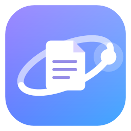

<p align="center"></p>

<h1 align="center">OrbitDrop</h1>
<p align="center"><b>Your files. Your flow.</b><br>Convert, edit and manage files without opening an app. For Windows 10 (19041+) and 11.</p>

## Download

**[⬇ Download OrbitDrop for Windows (installer)](https://github.com/i3sam/OrbitDrop/releases/download/v0.1.1-alpha/OrbitDrop-Setup.exe)** · [portable .zip](https://github.com/i3sam/OrbitDrop/releases/download/v0.1.1-alpha/OrbitDrop-Portable.zip) · [all releases](https://github.com/i3sam/OrbitDrop/releases)

Run the installer: no admin rights or .NET needed. This alpha isn't code-signed yet, so if Windows shows "Windows protected your PC", click **More info → Run anyway**.

> **Status: 0.1.1-alpha.** The core gesture is validated on Windows 11 (single monitor, 100% scale). Multi-monitor, mixed-DPI and Windows 10 sign-off are still pending; see [the feasibility report](docs/research/02-feasibility-report.md).

## How it works

1. Start dragging one or more files in File Explorer or on the desktop.
2. **Tap Shift** while you're still holding the mouse button. A radial wheel opens around the pointer.
3. Release on an option. The result appears **next to the original**, which is never changed.

Tap Shift again to switch **Convert → Tools → Actions**. Release on the centre or press **Esc** to cancel.

| Mode | 0.1.1 capabilities |
|---|---|
| Convert | Images: PNG ↔ JPG ↔ BMP ↔ TIFF ↔ GIF · Video: MP4, WMV, or extract audio as MP3 / M4A / WAV / WMA · Audio: MP3 ↔ M4A ↔ WAV ↔ WMA |
| Tools | Images: rotate, flip, grayscale · Video: compress to 720p, remove audio |
| Actions | Copy path, Copy name, Show in folder (any file) |

**Private by design:** everything runs locally. No uploads, no account, no telemetry.

## Build from source

Requirements: Windows 10/11 and the [.NET 10 SDK](https://dotnet.microsoft.com/download). For the installer, add [Inno Setup 6](https://jrsoftware.org/isinfo.php) (`winget install JRSoftware.InnoSetup`).

```powershell
dotnet build OrbitDrop.slnx -c Release
dotnet test tests/OrbitDrop.Tests
dotnet run --project src/OrbitDrop.App          # runs from source (lives in the notification area)
./build/package.ps1                             # → artifacts/: setup.exe, portable.zip, SHA256SUMS.txt
```

More detail: [docs/development/building.md](docs/development/building.md).

## Repository map

| Path | What |
|---|---|
| `src/OrbitDrop.App` | Composition root, tray lifecycle, interaction controller |
| `src/OrbitDrop.UI` | Design system, radial wheel, toasts, Settings, onboarding |
| `src/OrbitDrop.Windows` | Win32/COM: drag detection, OLE drop target, tray, theme, shell |
| `src/OrbitDrop.Core` | Operation contracts, registry, collision-safe atomic output |
| `src/OrbitDrop.Conversion` / `Tools` | Operation providers (add capabilities here) |
| `src/OrbitDrop.Jobs` / `Infrastructure` | Background jobs, settings, local logs |
| `experiments/OrbitProbe` | Feasibility probe, kept as a regression and diagnostics tool |
| `docs/` | Research, architecture, design system, milestones |

## Documentation

- [Initial assessment](docs/research/00-initial-assessment.md) · [Probe test sheet](docs/research/01-orbit-probe-test-sheet.md) · [Feasibility report](docs/research/02-feasibility-report.md)
- [Architecture & milestones](docs/architecture/03-architecture-and-milestones.md) · [Design system](docs/design/design-system.md) · [Milestone 1 summary](docs/milestones/M1-foundation.md)

## License

MIT. See [LICENSE](LICENSE) and [THIRD-PARTY-NOTICES.md](THIRD-PARTY-NOTICES.md). OrbitDrop is inspired by the interaction of Tangerine for Mac; it shares no code, artwork or branding with it.
